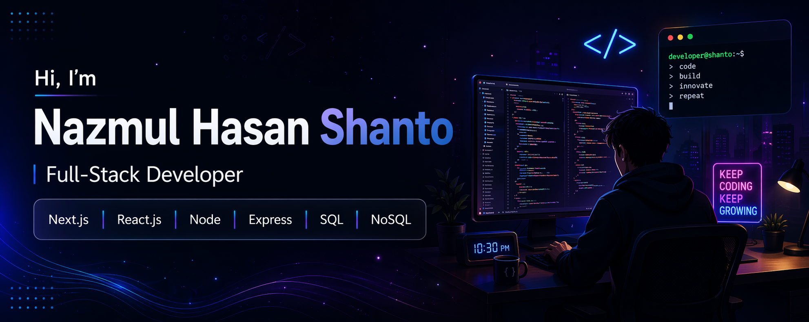

<h1 align="center">
  <a href="https://git.io/typing-svg">
   
  </a>
</h1>
<br/>

👇 Hit in your console or terminal to connect with me.

```
npx nazmul
```

<div align="center" style="display: flex; justify-content: center; align-items: center; gap: 6px; flex-wrap:wrap">

<p style="font-size:16px;">Let's connect:</p>

<a href="https://www.linkedin.com/in/nazmul-hasan-shanto-a67041182">

</a>
<a href="https://github.com/NazmulHasan18">

</a>
<a href="https://www.facebook.com/smnazmul.hasan.1829">

</a>
<a href="https://dev.to/nazmul_hasanshanto_572e5"> </a>
<a href="mailto:nazmulhasanshanto13@gmail.com"> </a>

</div>
<hr/>

<div align="center">
  <strong>
Hey, I'm Nazmul 👋

A Full Stack Web Engineer who loves turning complex problems into clean, scalable solutions.
I work across the entire stack — React & Next.js on the frontend, Node.js & Express on the backend,
and MongoDB or PostgreSQL under the hood.

When I'm not coding, I'm probably reading about systems design or optimizing something that didn't need optimizing.</strong>

</div>


### Talking about Personal Stuff:

<ul style="list-style-type: none; padding-left: 0;">
  <li>🛠 &nbsp; I’m currently working with <strong>TS, Next.js, Node, Express, MongoDB & Redux.</strong></li>
  <li>🚀 &nbsp; I’m currently deeply exploring <strong>Prisma, Docker.</strong></li>
  <li>📫 &nbsp; Reach me out: <strong>nazmulhasanshanto13@gmail.com</strong></li>
</ul>

### My Absolute Favorites:

<ul style="list-style-type: none; padding-left: 0;">
  <li>💻 &nbsp; I love exploring new technologies and building cool stuff.</li>
  <li>🍕 &nbsp; Meetups & Tech Events & Doing Math.</li>
</ul>

<hr/>

<h2 align="center">🔥 Languages & Frameworks & Tools 🔥</h2>

<div align="center">
  <code></code>
  <code></code>
  <code></code>
  <code>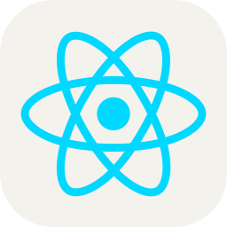</code>
  <code>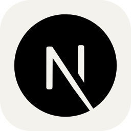</code>
  <code></code>
  <code>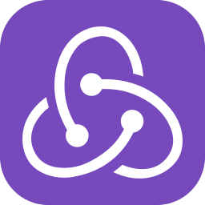</code>
  <code>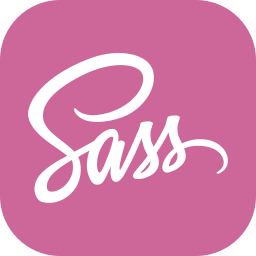</code>
  <code>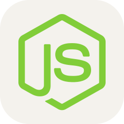</code>
  <code></code>
  <code></code>
  <code>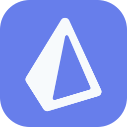</code>
  <code>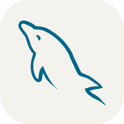</code>
  <code>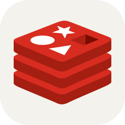</code>
  <code></code>
  <code>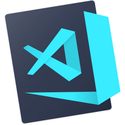</code>
  <code></code>
  <code></code>
  <code>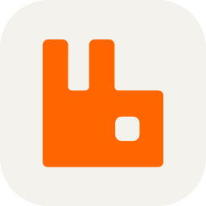</code>
  <code>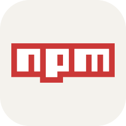</code>
</div>

<br/>

## 📊 This Week I Coded In

<!--START_SECTION:waka-->
**I'm an Early 🐤** 

```text
🌞 Morning                1159 commits        ████░░░░░░░░░░░░░░░░░░░░░   16.77 % 
🌆 Daytime                3641 commits        █████████████░░░░░░░░░░░░   52.68 % 
🌃 Evening                2051 commits        ███████░░░░░░░░░░░░░░░░░░   29.67 % 
🌙 Night                  61 commits          ░░░░░░░░░░░░░░░░░░░░░░░░░   00.88 % 
```
📅 **I'm Most Productive on Tuesday** 

```text
Monday                   1309 commits        █████░░░░░░░░░░░░░░░░░░░░   18.94 % 
Tuesday                  1313 commits        █████░░░░░░░░░░░░░░░░░░░░   19.00 % 
Wednesday                1226 commits        ████░░░░░░░░░░░░░░░░░░░░░   17.74 % 
Thursday                 1284 commits        █████░░░░░░░░░░░░░░░░░░░░   18.58 % 
Friday                   752 commits         ███░░░░░░░░░░░░░░░░░░░░░░   10.88 % 
Saturday                 668 commits         ██░░░░░░░░░░░░░░░░░░░░░░░   09.66 % 
Sunday                   360 commits         █░░░░░░░░░░░░░░░░░░░░░░░░   05.21 % 
```


📊 **This Week I Spent My Time On** 

```text
💬 Programming Languages: 
TypeScript               8 hrs 25 mins       ██████████░░░░░░░░░░░░░░░   40.41 % 
JavaScript               6 hrs 16 mins       ████████░░░░░░░░░░░░░░░░░   30.06 % 
Markdown                 2 hrs 58 mins       ████░░░░░░░░░░░░░░░░░░░░░   14.26 % 
Other                    2 hrs 7 mins        ███░░░░░░░░░░░░░░░░░░░░░░   10.21 % 
Bash                     1 hr 1 min          █░░░░░░░░░░░░░░░░░░░░░░░░   04.95 % 
```

🤖 **AI Coding This Week** 

```text
⏱ AI Coding Time: 18 hrs 51 mins (90.43%)

✍️ 6,183 lines written by AI, 33 lines written by hand (99.47% AI-written)

🔤 5,224,532 Input Tokens, 1,423,441 Output Tokens

💵 $110.15 Estimated AI Cost This Week

🧠 49 AI Sessions, 295 AI Prompts

Opus                     6,787 lines         █████████████████████████   100.00 % 
Claude-Code              0 lines             ░░░░░░░░░░░░░░░░░░░░░░░░░   00.00 % 

🔎 AI Coding Insights:
🤖 AI-Driven — 99.47% of written lines came from AI
📄 Detailed Prompter — average 740 characters per prompt
🔁 Iterative Prompter — average 6 prompts per session
🚀 High AI Trust — 1.01% of changed lines were hand-edited
```


 Last Updated on 09/11/2026 05:14:33 UTC
<!--END_SECTION:waka-->

---

<div align="center">

### 😄 Before You Go...

_Every great developer needs a laugh break!_


_Thanks for visiting! Come back anytime — I'll have fresh code and fresh jokes_ 😄

<br/>


**Made with ☕ and too much ❤️ by Nazmul**

</div>
